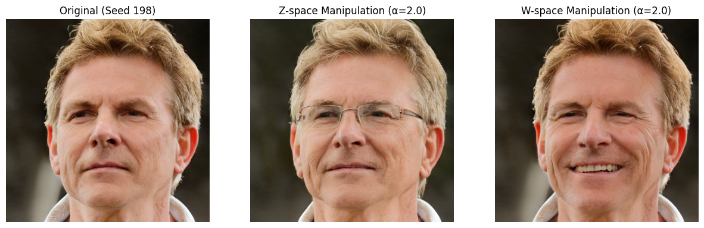
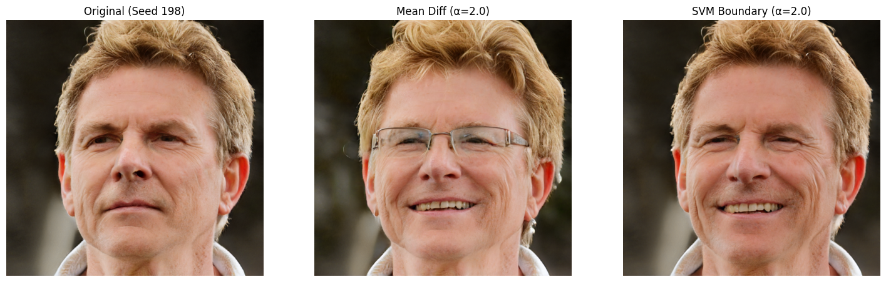
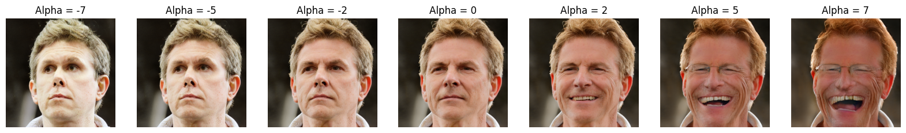
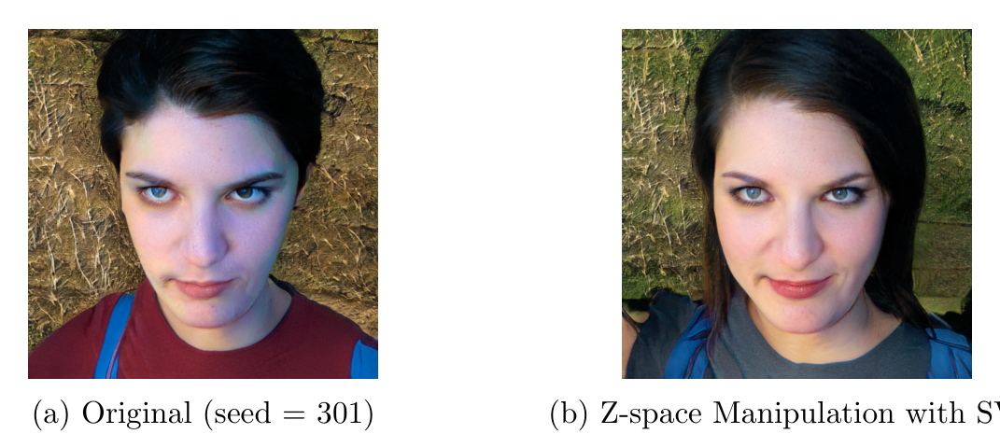
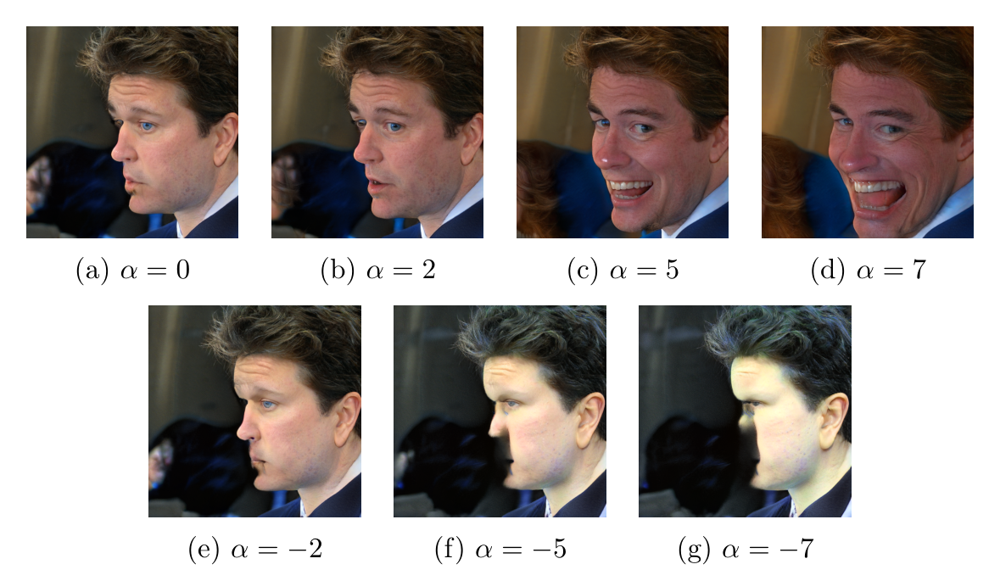
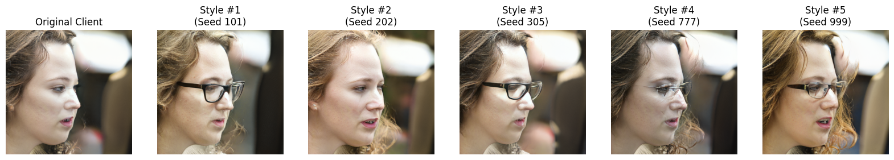
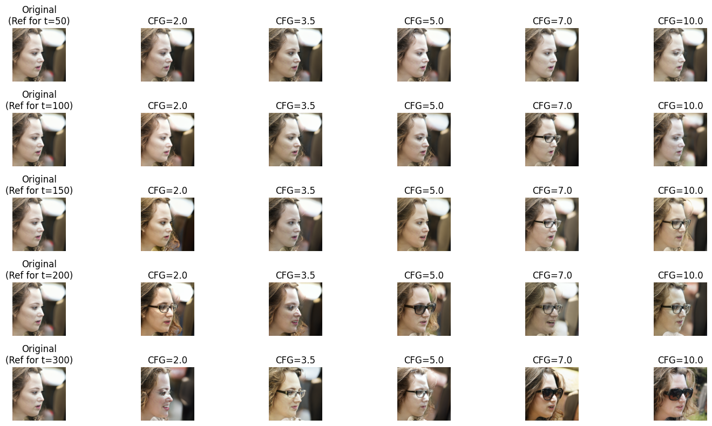
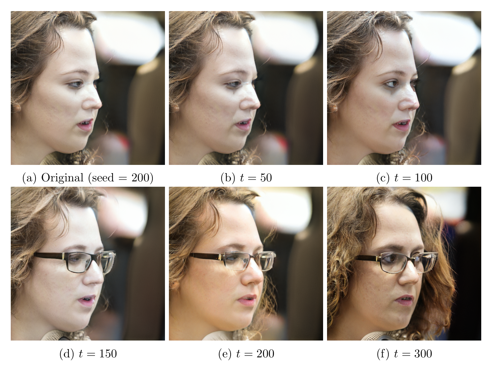
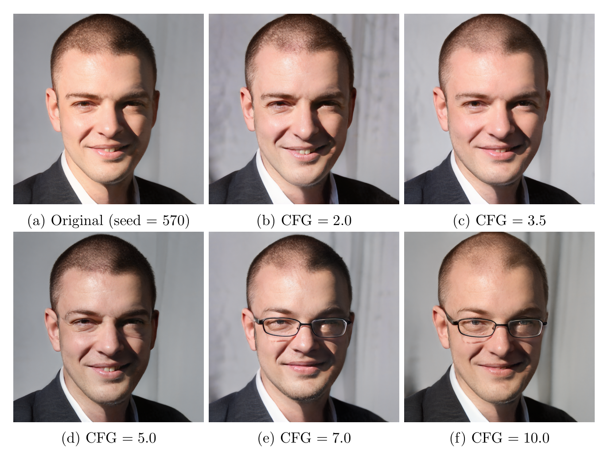
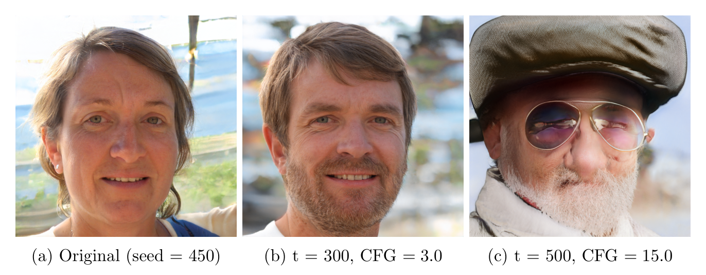

# Latent Space Manipulation & Conditional Latent Diffusion with StyleGAN2

This repository contains the two term projects completed for **MATH 482: Probabilistic Approach to Machine Learning** at Boğaziçi University (Fall 2025) by **Toprak Özdemir** and **Hüseyin Çiyik**.

Both projects explore semantic facial attribute manipulation in the latent space of a pre-trained **StyleGAN2-ADA** generator (FFHQ):
- **Project 1** investigates **linear manipulation** ($v_{\text{new}} = v_{\text{old}} + \alpha \cdot n$), comparing the initial latent space $\mathcal{Z}$ against the intermediate disentangled space $\mathcal{W}$, and evaluating two direction discovery methods: **Mean Difference** and **Linear SVM**.
- **Project 2** implements a **Conditional Latent Diffusion Model (LDM)** using a **Residual MLP** and **SDE-Edit** with **Classifier-Free Guidance (CFG)** to perform non-linear, probabilistic edits in $\mathcal{W}$ space, and compares the results directly with Project 1.

**Documents and notebooks in this repository:**
- **Project 1 — Latent Space Manipulation with StyleGAN2:** [**Notebook (.ipynb)**](project1_latent_manipulation/stylegan2_latent_manipulation.ipynb) | [**Report (PDF)**](project1_latent_manipulation/report.pdf) ([LaTeX source](project1_latent_manipulation/report.tex))
- **Project 2 — Conditional Latent Diffusion with StyleGAN2:** [**Notebook (.ipynb)**](project2_latent_diffusion/stylegan2_latent_diffusion.ipynb) | [**Report (PDF)**](project2_latent_diffusion/report.pdf) ([LaTeX source](project2_latent_diffusion/report.tex))

---

## Project 1: Latent Space Manipulation with StyleGAN2

### Setup & Methodology

In Project 1, we explore the latent space of StyleGAN2 trained on the FFHQ dataset (`ffhq.pkl`). Our objective is to identify semantic directions corresponding to specific facial attributes (specifically **"Smiling"**) and manipulate these attributes using linear interpolation in latent space:

$$
v_{\text{new}} = v_{\text{old}} + \alpha \cdot n
$$

1. **Attribute Classifier Training:**
   To label the generated images, we fine-tuned a pre-trained **ResNet-18** model on the **CelebA** dataset (over 200,000 celebrity images with 40 attribute annotations) to detect the *Smiling* attribute (Index 31). The final fully connected layer was modified to output a single logit for binary classification using `BCEWithLogitsLoss` and the Adam optimizer ($\text{lr} = 0.001$) for 2 epochs. On the validation set (20% of the sample), the classifier achieved an accuracy of approximately **92.5%**.
2. **Latent Space Exploration & Dataset Generation:**
   We sampled 5,000 random latent vectors $z \in \mathcal{Z}$ from a standard normal distribution (seed `168`), passed them through the StyleGAN2 mapping network to obtain the corresponding intermediate vectors $w \in \mathcal{W}$, and generated the images $G(w)$. After resizing to $224 \times 224$, images with classification probability $p > 0.5$ were labeled as positive (1), and others as negative (0), resulting in a paired dataset $(\mathbf{z}, \mathbf{w}, y)$ of 5,000 samples.
3. **Direction Discovery:**
   We calculated the semantic direction $n$ in both $\mathcal{Z}$ space and $\mathcal{W}$ space using two methods:
   - **Mean Difference:** $n_{\text{mean}} = \mu_{\text{pos}} - \mu_{\text{neg}}$
   - **Linear SVM:** $n_{\text{svm}}$ is the normal vector to the separating hyperplane.

### Results

#### 1. Latent Space Analysis: *Z* vs. *W*
The core innovation of StyleGAN is the mapping network:
- ***Z*-Space ($\mathcal{Z}$):** The input latent code $z \in \mathcal{Z}$ is sampled from a standard normal distribution $\mathcal{N}(0, I)$. This space is "entangled" because the generator must "bend" the input to match the probability density of the training data. For example, if "long hair" and "feminine features" are correlated in the dataset, the structure of $\mathcal{Z}$ forces these features to be entangled in the representation.
- ***W*-Space ($\mathcal{W}$):** The mapping network $f: \mathcal{Z} \to \mathcal{W}$ transforms $z$ into an intermediate vector $w$. This space is not restricted to a fixed probability distribution, allowing it to "unbend" the data manifold. This results in a "disentangled" representation where linear directions correspond more consistently to single semantic changes.

Our experiments confirm this theory. Manipulating the vector in $\mathcal{Z}$ space resulted in significant changes to the subject's identity and adding glasses, whereas $\mathcal{W}$ space manipulation preserved the identity while only altering the target attribute:

<p align="center">
  
</p>
<p align="center"><em>Comparison of manipulation in Z vs. W space (α = 2.0 with SVM, seed = 198). Note how W-space preserves identity better.</em></p>

#### 2. Method Comparison: Linear SVM vs. Mean Difference
We computed the cosine similarity between the two direction vectors in $\mathcal{W}$ space:

$$
\text{Cosine Similarity} \approx 0.3315
$$

This value corresponds to an angle of approximately $70^\circ$. While both methods generally point towards the "Smiling" region, they take significantly different paths, and the **Linear SVM** yielded better perceptual results:
- The **Mean Difference** vector captures the average difference between populations. Since the dataset contains biases (e.g., smiling faces might be correlated with specific lighting, gender, or artifacts), the Mean Difference vector entangles these biases into the direction. In our experiment, the Mean Difference method adds glasses to the subject and changes the shape of the face more.
- The **SVM** finds the decision boundary that best separates the classes. This discriminative approach isolates the specific feature change required to flip the label, resulting in a clearer transformation with fewer artifacts.

<p align="center">
  
</p>
<p align="center"><em>Visual comparison of direction finding methods in W-space with α = 2.0 (seed = 198).</em></p>

#### 3. Entanglement Analysis & Failure Cases
- **Entanglement:** Entanglement occurs when changing one attribute inadvertently changes another. We observed this frequently in $\mathcal{Z}$ space and/or while using the Mean Difference method. For example, when applying the "Smiling" vector (found by SVM) in $\mathcal{Z}$ space to a male subject (seed = 301), the model inadvertently changes the gender and the shirt color, revealing that the semantic concept of "Smiling" in the training data is statistically correlated with gender.
- **Alpha Scaling Limits:** Linearity in the latent space only holds locally. Applying extreme values ($\alpha \in \{-7, -5, 5, 7\}$) pushes the latent vector into low-density regions of the distribution, resulting in severe artifacts and unrealistic distortions.
- **Semantic Failure (Pose):** On a profile-view face (seed = 3879), the StyleGAN2 generator struggles to rotate the facial geometry to accommodate a smile, resulting in distorted jawlines and background. This highlights that the linear direction $n$ cannot account for complex 3D geometric constraints.

<p align="center">
  
</p>
<p align="center"><em>Comparison of different alpha values (α ∈ {−7, −5, −2, 0, 2, 5, 7}) in W-space with the SVM method (seed = 198).</em></p>

<p align="center">
  
  
</p>
<p align="center"><em><b>Left:</b> Example of entanglement in Z-space (seed = 301, α = 2.0). <b>Right:</b> Failure case where manipulation breaks the geometry of a profile-view face (seed = 3879).</em></p>

---

## Project 2: Conditional Latent Diffusion with StyleGAN2

### Methodology

In Project 1, we explored linear manipulation in the latent space of StyleGAN2 ($\mathcal{W}$ space) to edit facial attributes. While effective for simple edits, linear interpolation assumes a flat data manifold, which can lead to unnatural distortions when traversing "empty" regions of the latent space.

In Project 2, we implement a **Conditional Latent Diffusion Model (LDM)**. Unlike linear interpolation, this probabilistic approach learns the distribution of valid latent vectors. By training a diffusion model directly on the $\mathcal{W}$ space vectors, we can perform controlled, non-linear edits (such as adding eyeglasses) while ensuring the modified vector remains on the manifold of realistic faces.

1. **Dataset Preparation:**
   Instead of operating on pixels (which would require computationally expensive U-Nets), we operate on the compressed 512-dimensional $\mathcal{W}$ space of StyleGAN2:
   - **Latent Vectors:** We generated 20,000 random latent vectors $w \in \mathbb{R}^{512}$ using the StyleGAN2 mapping network (approximately 15% of the sample have eyeglasses).
   - **Attribute Classification:** We used a ResNet-18 classifier (trained on CelebA) to label these vectors for our target attribute: **Eyeglasses** (Index 15).
   - **Data Normalization:** To satisfy the standard diffusion assumption of $w \sim \mathcal{N}(0, 1)$, we computed the global mean and standard deviation of our dataset and normalized all vectors before training. The same statistics are used to denormalize edited latents before image synthesis.
2. **Model Architecture (Residual MLP):**
   Since our input data is 1D (vector) rather than 2D (image), we used a **Residual MLP (Multi-Layer Perceptron)** instead of Conv2D:
   - **Input:** Noisy latent vector $w_t$ (512), Time embedding $t_{\text{emb}}$ (256), Context embedding $c_{\text{emb}}$ (256).
   - **Time Embeddings:** Sinusoidal Position Embeddings map the scalar timestep $t$ to a high-dimensional vector, allowing the network to distinguish between noise levels effectively.
   - **Residual Blocks:** Series of linear layers with residual connections ($y = x + F(x)$), which is critical for diffusion models to preserve the signal structure throughout the deep network.
3. **Training Strategy:**
   We trained the model to predict the noise $\epsilon$ added to the latent vector:
   - **Objective:** Standard MSE Loss: $\mathcal{L} = \lVert \epsilon - \epsilon_\theta(w_t, t, c) \rVert^2$.
   - **Schedule:** Linear $\beta$ schedule from $10^{-4}$ to $0.02$ over $T = 1000$ steps.
   - **Classifier-Free Guidance (CFG):** During training, the condition label $c$ was randomly dropped (replaced with a null token) with probability $p = 0.1$, forcing the model to learn both conditional $P(w \mid c)$ and unconditional $P(w)$ distributions simultaneously.
4. **Sampling (SDE-Edit):**
   Unlike deterministic inversion (DDIM), **SDE-Edit** (Stochastic Differential Editing) involves a destructive forward process up to step $t_{\text{start}}$ followed by a stochastic generative reverse process:

$$
w_{t-1} = \frac{1}{\sqrt{\alpha_t}} \left( w_t - \frac{1-\alpha_t}{\sqrt{1-\bar{\alpha}_t}} \epsilon_\theta(w_t, t, c) \right) + \sigma_t z
$$

where $z \sim \mathcal{N}(0, I)$ is the explicitly injected Langevin noise. We used this stochasticity to help the model "imagine" new features (like glasses frames) that were not present in the original image.

### Experiments and Results

Because manipulation in this setting is stochastic, manipulating the same source image with different seeds yields different eyeglasses styles:

<p align="center">
  
</p>
<p align="center"><em>Manipulating the same source image (seed = 200) with different random seeds (t<sub>start</sub> = 200, CFG = 2.0).</em></p>

#### 1. Task: Virtual Optician (Starting Noise vs. CFG Matrix)
Our primary experiment focused on the **"Virtual Optician"** task: taking a source face without glasses (seed = 200) and modifying the latent vector to add eyeglasses across combinations of starting noise levels ($t_{\text{start}} \in \{50, 100, 150, 200, 300\}$) and guidance scales ($\text{CFG} \in \{2.0, 3.5, 5.0, 7.0, 10.0\}$):

<p align="center">
  
</p>
<p align="center"><em>Effect of varying starting noise levels t (top to bottom) and varying CFG values (left to right) on seed = 200.</em></p>

Low noise levels (first row, $t = 50$) are the main determinant of identity preservation even with relatively high CFG values, though the model struggles to add eyeglasses until $\text{CFG} = 10.0$. At moderate noise levels ($t = 100, 150$), the model can hallucinate eyeglasses with lower CFG values without distorting the image too much. At higher noise levels ($t = 200, 300$), adding eyeglasses becomes much easier, but the original identity changes so much that the person cannot be recognized anymore.

#### 2. Noise Level Analysis & Guidance Scale Analysis

<p align="center">
  
  
</p>
<p align="center"><em><b>Left:</b> Effects of different noise levels (t ∈ {50, 100, 150, 200, 300}) on identity preservation at fixed CFG = 3.0 (seed = 200). <b>Right:</b> Effects of different guidance scales (ε̃ = ε<sub>uncond</sub> + s · (ε<sub>cond</sub> − ε<sub>uncond</sub>)) at fixed t = 100 (seed = 570).</em></p>

- **Noise Level Analysis ($\text{CFG} = 3.0$, seed = 200):**
  - **Low Noise ($t = 50$):** The identity is perfectly preserved, but the glasses fail to appear or appear as faint "ghost" artifacts because the vector remains too close to the original "no-glasses" state.
  - **Low-Medium Noise ($t = 100$):** The identity starts to change slightly (eye angle, subtle light/color shift), but the glasses still do not appear.
  - **Medium Noise ($t = 150$):** A sweet spot. The glasses appear clearly with defined frames, and the person's identity is largely recognizable.
  - **Medium-High & High Noise ($t = 200, 300$):** The glasses are very realistic, but the facial identity changes significantly or completely (face shape, hair, and background changes).
- **Guidance Scale Analysis ($t = 100$, seed = 570):**
  - **Scale $s = 2.0 - 3.5$:** The edit is weak; glasses are missing or barely visible.
  - **Scale $s = 5.0$:** The "ghost" frame of the glasses starts to appear.
  - **Scale $s = 7.0$:** Sweet spot for this experiment; the glasses are robustly generated and clearly visible.
  - **Scale $s = 10.0$:** The glasses become more saturated and expressive, but face shape starts to change more.

---

## Discussion: Linear (Project 1) vs. Diffusion (Project 2)

1. **Latent Diffusion vs. Pixel Diffusion:**
   Training a diffusion model on the $\mathcal{W}$ latent space (512 dimensions) offers massive computational advantages over pixel space ($1024 \times 1024 \times 3$ dimensions). Our MLP is lightweight and trains in minutes, whereas pixel-based diffusion requires days on high-end GPUs. Because StyleGAN's $\mathcal{W}$ space captures high-level semantic dependencies, the Latent Diffusion model inserts eyeglasses that are 3D-consistent with the subject's head pose, lighting, and shadows, rather than simply "pasting" pixels over the eyes.
2. **The Noise vs. Identity Trade-off:**
   Adding more noise (higher $t_{\text{start}}$) deletes more information about the original subject, giving the model the necessary "freedom" to hallucinate new object geometry (like glasses frames) that did not exist before, while also corrupting identity-specific features. Because the reverse process is stochastic, the model fills in missing information based on the learned distribution rather than the specific original face, drifting toward a "generic" face with glasses as $t$ increases.
3. **Linear Interpolation (Project 1) vs. Conditional Diffusion (Project 2):**
   - **Project 1 (Linear):** Better at **Identity Preservation**. Since we simply add a vector offset, the base facial structure remains mathematically identical. However, it often produces unrealistic artifacts (e.g., lighting inconsistencies) because the linear path leaves the natural data manifold.
   - **Project 2 (Diffusion):** Superior in **Realism**. The diffusion process iteratively projects the vector back onto the manifold of valid faces, so the generated glasses look physically grounded (correct reflections and shadows). However, it struggles more with identity consistency due to the destructive nature of the noise-denoise process.
4. **Failure Cases in Diffusion:**
   When excessive noise or strong guidance overwrites identity-related latent components, the model can exhibit **Identity Drift** (e.g., changing the person's gender due to dataset correlations) or severe **Artifacts** ("mutated" faces when $t_{\text{start}}$ and/or CFG scale are too high, such as $t = 500, \text{CFG} = 15.0$):

<p align="center">
  
</p>
<p align="center"><em>Examples of failure cases in Project 2 (seed = 450): (a) Original, (b) Identity/gender drift at t = 300, CFG = 3.0, (c) Severe artifacts at t = 500, CFG = 15.0.</em></p>

---

## Repository structure

```text
.
├── project1_latent_manipulation/
│   ├── stylegan2_latent_manipulation.ipynb   # Project 1 notebook (with outputs)
│   ├── report.pdf                            # Project 1 report (compiled PDF)
│   └── report.tex                            # Project 1 report (LaTeX source)
├── project2_latent_diffusion/
│   ├── stylegan2_latent_diffusion.ipynb      # Project 2 notebook (with outputs)
│   ├── report.pdf                            # Project 2 report (compiled PDF)
│   └── report.tex                            # Project 2 report (LaTeX source)
├── figures/
│   ├── project1/                             # Figures from Project 1
│   └── project2/                             # Figures from Project 2
├── CITATION.cff
├── LICENSE
├── requirements.txt
└── README.md
```

## How to run

Both notebooks were run on Kaggle / Google Colab with NVIDIA Tesla T4 GPUs (Python 3.11–3.12, PyTorch 2.x).

```bash
git clone https://github.com/toprak-ozdemir/stylegan2-latent-manipulation-and-diffusion.git
cd stylegan2-latent-manipulation-and-diffusion
pip install -r requirements.txt
```

1. **StyleGAN2-ADA & Pre-trained Weights:** Section 1 and Section 2 of each notebook automatically clone the official [StyleGAN2-ADA PyTorch](https://github.com/NVlabs/stylegan2-ada-pytorch) repository and download the pre-trained FFHQ weights (`ffhq.pkl`).
2. **CelebA Dataset:** Attach the [CelebA dataset](https://www.kaggle.com/datasets/jessicali9530/celeba-dataset) in Kaggle/Colab (or update the dataset path in the notebook) to train the ResNet-18 attribute classifiers.

## License

The code and reports in this repository are released under the [MIT License](LICENSE) by Toprak Özdemir and Hüseyin Çiyik.
